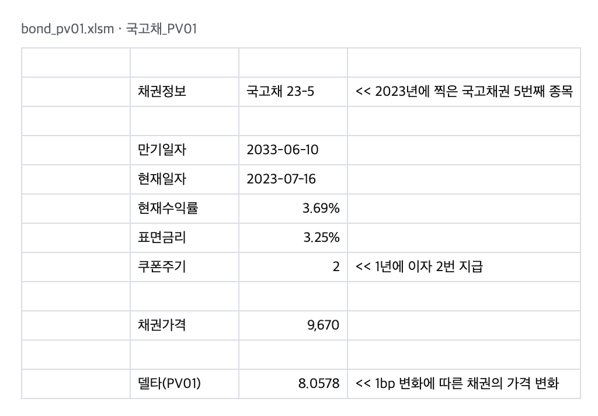
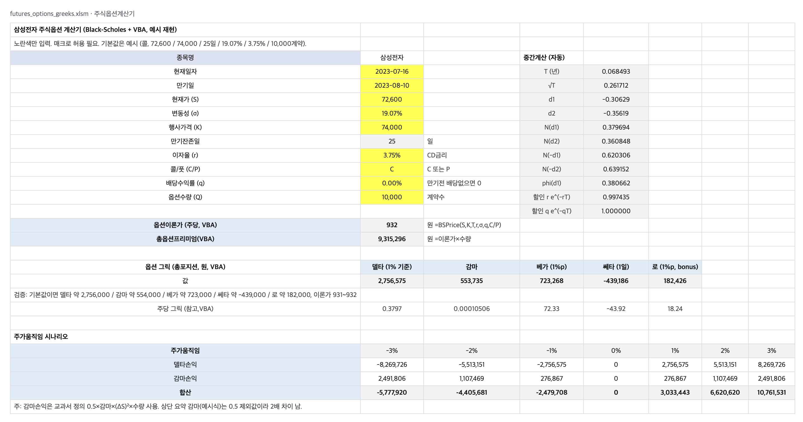
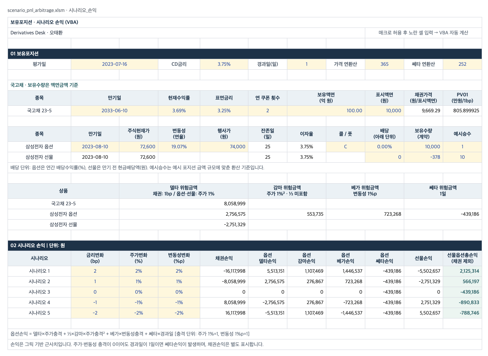
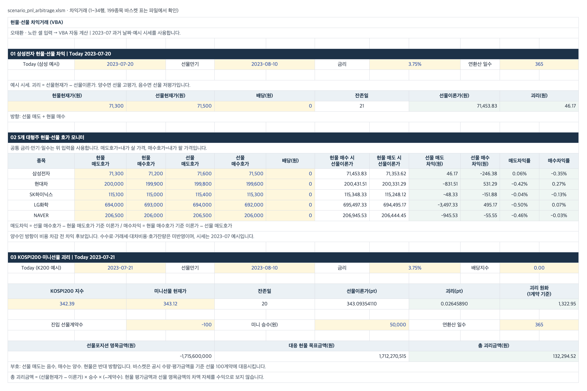

# Derivatives Desk in Excel/VBA

**증권사 운용 데스크의 기초 계산을 Excel/VBA로 직접 만든 도구 모음입니다.**
채권 가격과 PV01에서 시작해 주식선물·옵션 이론가와 그릭, 채권·옵션·선물 북의 시나리오 손익, 현·선물 및 KOSPI200 바스켓 차익거래까지 한 단계씩 쌓았습니다.

> Bond pricing and PV01, Black-Scholes Greeks, scenario P&L for a delta-hedged bond / option / futures book, and cash-futures and KOSPI200 basket arbitrage. Excel workbooks with VBA pricing functions and self-check macros that verify units, baselines, and basket integrity.

| 워크북 | 다루는 것 | 핵심 결과 |
| --- | --- | --- |
| `bond_pv01.xlsm` | 국고채 가격·PV01 | 가격 9,669.54, PV01 8.06 (액면 10,000) |
| `futures_options_greeks.xlsm` | 주식선물 이론가, Black-Scholes 가격·그릭 | 선물 73,604 · 콜 931.53원 · 그릭 5종 |
| `scenario_pnl_arbitrage.xlsm` | 시나리오 손익, 현·선물 차익, KOSPI200 바스켓 | 5개 시나리오 손익 · 199종목 바스켓 정수 주 재현 |

## 1. 채권 가격과 PV01



- 대상: 국고채 23-5 (만기 2033-06-10, 표면금리 3.25%, 시장수익률 3.69%, 연 2회 이표, 평가일 2023-07-16)
- `BondDirtyPrice`: 평가일 이후 남은 이표를 역산해 현재가치를 합산합니다.
- `BondPV01`: 수익률을 ±1bp 움직인 두 가격 차이의 절반, 즉 중앙차분입니다.
- 부분기간 할인 방식은 두 가지를 비교했습니다. 복리 `(1+r)^(w+i)`는 9,669.54, 국고채 시장 관행인 단리 `1/(1+r·w)`는 9,669.29가 나옵니다. 시나리오 손익 워크북은 단리 관행을 씁니다.

## 2. 주식선물과 옵션 그릭



- 선물 이론가: `F = S × (1 + r × T/365) − 배당`. 삼성전자 S 73,400, r 3.75%, 27일 → **73,604**
- 옵션: 배당수익률 q를 넣은 Black-Scholes. S 72,600, K 74,000, 25일, σ 19.07% 콜 → **931.53원/주**, 수량 10,000 기준 총프리미엄 9,315,296원
- 포지션 그릭: 델타(주가 1%) 2,756,575 · 감마 553,735 · 베가(변동성 1%p) 723,268 · 쎄타(1일) −439,186 · 로 182,426
- 기간은 365일 기준이고, 쎄타 일할만 252 거래일로 나눕니다. 식과 가정은 `표지_식정리` 시트에 따로 정리했습니다.

## 3. 채권·옵션·선물 북의 시나리오 손익



- 포지션: 국고채 액면 100억, 삼성전자 콜옵션 10,000, 삼성전자 선물 **−378계약**
- 선물 델타 −2,751,329가 옵션 델타 2,756,575를 거의 상쇄합니다. 순델타는 약 +5,000원으로, 옵션 델타를 선물로 헤지한 북입니다.
- 손익식: `델타×ΔS + ½×감마×ΔS² + 베가×Δσ + 쎄타×경과일`, 채권은 `−PV01×Δbp`
- 예: 금리 +2bp, 주가 +2%, 변동성 +2%p → 채권 −16,117,998원, 선물·옵션 합계 +2,125,314원

## 4. 현·선물 차익과 지수 바스켓



- 삼성전자: 현물 71,300, 선물 71,500, 이론가 71,453.83 → 괴리 **+46.17원**. 선물 매도와 현물 매수 방향입니다.
- 5종목 호가 모니터: 매도·매수 호가를 나눠 양방향 차익을 계산합니다. 비용 차감 전 기준으로 현대차 매수차익 +531원, LG화학 매수차익 +495원이 후보입니다.
- KOSPI200: 지수 342.39, 미니선물 343.12, 이론가 343.09 → 괴리 0.026pt. 미니선물 100계약 매도에 대응하는 현물은 1,712,270,515원입니다.
- 바스켓: 삼성자산운용 KODEX 200의 2023-07-21 구성종목 공시로 **199종목 전체**를 정수 주로 재현했습니다. 절사 잔액은 0원입니다.

## 검증

계산이 맞는지 숫자로 확인하는 VBA 자체 검사 매크로를 넣었습니다.

| 매크로 | 확인 내용 |
| --- | --- |
| `CheckScenarioPnL` | 수식 오류 없음, 채권 bp·델타·감마 ½·베가·쎄타·선물 단위, 감마 대칭, 잘못된 단위 입력 거부, 옵션·선물 기준값 |
| `CheckArbitrage` | 선물 이론가 기준값, 5종목 양방향 괴리 재계산, KOSPI200 이론가·총괴리, 바스켓 종목 수 199·비중 합 1·절사 잔액 |
| `CheckZeroPosition` | 포지션을 0으로 두면 모든 손익이 0인지 확인하고 입력값을 복원 |

2026-09-28 Mac Excel에서 세 워크북을 열어 전체 재계산한 값이 위 숫자와 같은지 확인했고, 세 매크로 모두 통과했습니다.

## 파일 구성

```text
workbooks/
  bond_pv01.xlsm                 국고채 가격·PV01
  futures_options_greeks.xlsm    표지_식정리 · 주식선물계산기 · 주식옵션계산기
  scenario_pnl_arbitrage.xlsm    시나리오_손익 · 차익거래
vba/                             워크북에서 꺼낸 VBA 원본 (.bas)
docs/images/                     시트 화면 (셀 값을 그대로 렌더링)
```

## 실행

1. `workbooks/`의 파일을 Excel에서 열고 매크로를 허용합니다.
2. 노란 셀이 입력값입니다. 값을 바꾸면 VBA 사용자 함수가 다시 계산합니다.
3. 검사는 `개발 도구 → 매크로`에서 `CheckScenarioPnL`, `CheckArbitrage`, `CheckZeroPosition`을 실행합니다.

VBA만 보고 싶다면 `vba/` 폴더의 `.bas` 파일을 읽거나 Excel VBA 편집기에서 가져오기로 불러옵니다.

## 한계

- 입력 시세와 날짜는 2023년 7월 기준 예시값입니다. 실제 시장 성과가 아닙니다.
- 수수료, 거래세, 대차비용, 호가 잔량, 체결 가능성은 반영하지 않았습니다.
- 옵션은 유럽형 Black-Scholes, 손익은 그릭 기반 근사입니다. 선물은 단순 carry 모형입니다.
- KODEX 200 구성종목은 삼성자산운용 공시 자료입니다.
